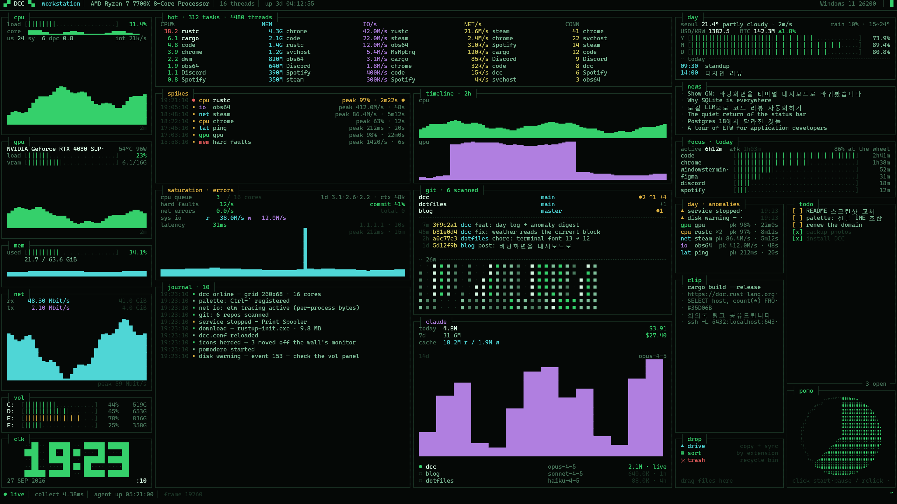
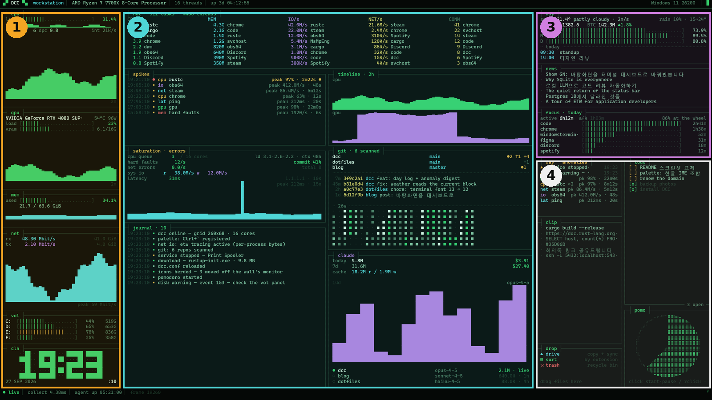
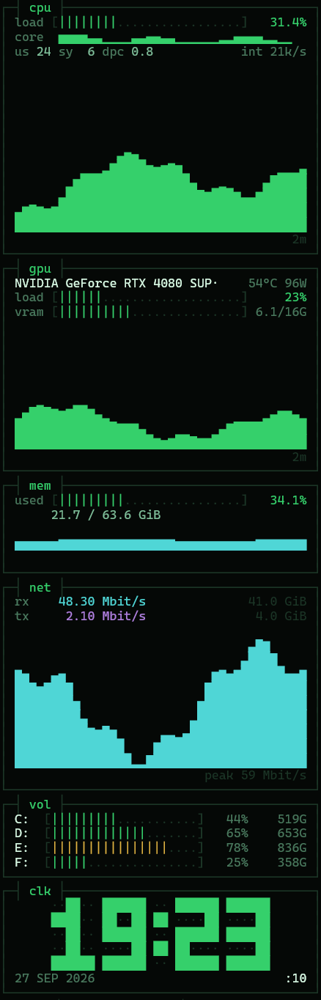
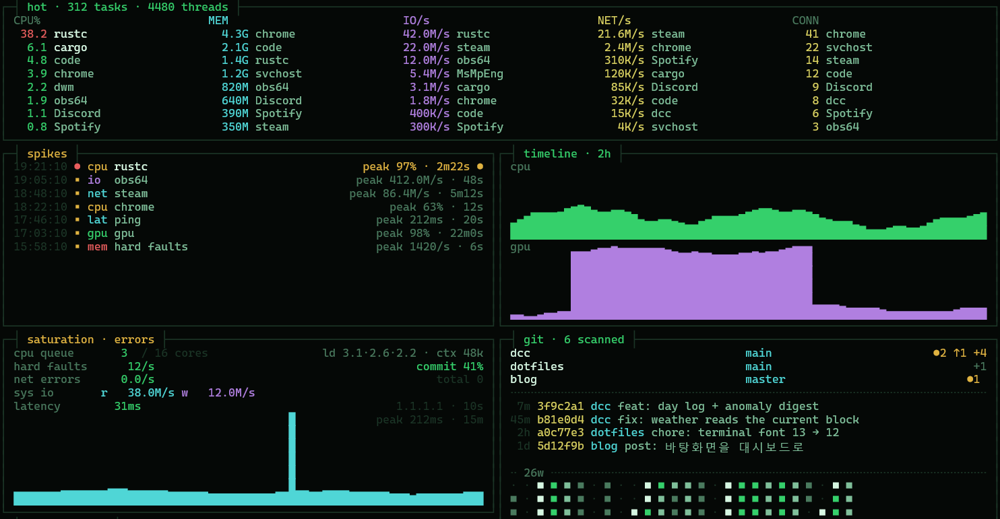
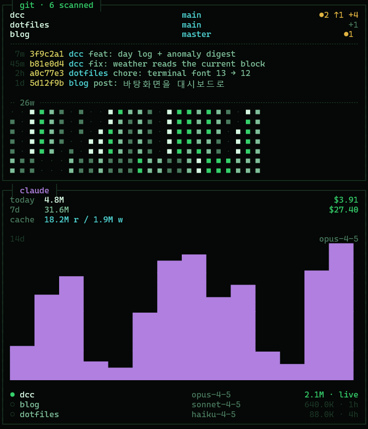
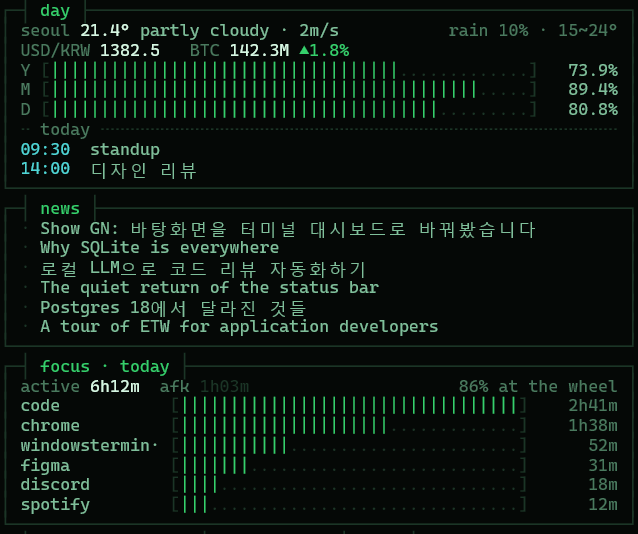
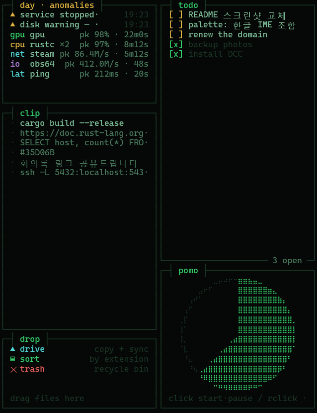

# DCC — DevOps Command Center

윈도우 바탕화면을 대체하는 실시간 대시보드입니다. 시스템 자원과 그 자원을 쓰는 프로세스, 오늘 하루의 정보, 자주 쓰는 작은 도구들을 터미널 스타일 한 화면에 모아 보여주고, 마우스로 바로 조작할 수 있습니다.

[English](README.md) · **한국어**


<sub>`dcc.exe --shot --demo`로 렌더링한 화면입니다 (예시 데이터).</sub>

## 요구 사항

- Windows 10 / 11, 64비트
- 빌드용 [Rust](https://rustup.rs) (stable)
- Cascadia Mono 글꼴 (Windows 11, Windows 터미널에 기본 포함)

선택 사항 — 있으면 해당 패널이 켜지고, 없어도 DCC는 정상 동작합니다: NVIDIA GPU (gpu 패널), [git](https://git-scm.com) (git 패널), [Claude Code](https://claude.com/claude-code) (claude 패널), [ActivityWatch](https://activitywatch.net) (focus 패널), [Everything](https://www.voidtools.com) (팔레트 파일 검색), Google Drive 데스크톱 앱 (drop 패널).

## 설치

```powershell
git clone https://github.com/patissierMongs/dcc-native
cd dcc-native
cargo build --release
target\release\dcc.exe --install
```

`--install`은 관리자 권한을 한 번 요청한 뒤, 로그인할 때마다 DCC가 자동으로 실행되도록 등록하고 바로 시작합니다. 관리자 권한이 있어야 프로세스별 네트워크 사용량을 측정할 수 있으며, 권한이 없으면 해당 열에 연결 수가 대신 표시됩니다.

- 설치 없이 실행: `target\release\dcc.exe` (종료는 `dcc.exe --stop`)
- 일반 창으로 미리보기: `dcc.exe --window`
- 제거: `dcc.exe --uninstall` (설정은 `%LOCALAPPDATA%\dcc`에 남습니다)

> DCC가 덮는 모니터는 더 이상 바탕화면으로 동작하지 않습니다. 모니터가 여러 대면 바탕화면 아이콘을 다른 모니터로 옮기고, 한 대뿐이면 아이콘은 대시보드 뒤에 가려집니다. 그 모니터에서는 우클릭해도 바탕화면 메뉴가 뜨지 않습니다.

## 사용법

바탕화면은 키보드 포커스를 가져가지 않습니다. 마우스와 단축키 하나로 조작합니다.

| 동작 | 결과 |
| --- | --- |
| 마우스 올리기 | 행 강조, 뽀모도로 위에서는 남은 시간 표시 |
| 클릭 | 뉴스 열기 · 클립보드 항목 다시 복사 · 할 일 체크 · 저널 항목의 파일 열기 · 오늘 로그 열기(anomalies 패널) · 뽀모도로 시작/일시정지 |
| 우클릭 | 뽀모도로 초기화 |
| 휠 | 저널 이전 기록 스크롤 |
| 파일 끌어다 놓기 | drop 패널: drive / sort / trash |
| <kbd>Ctrl</kbd> + <kbd>`</kbd> | 명령 팔레트 열기 |

**팔레트**

| 입력 | 결과 |
| --- | --- |
| 런처 이름 일부 | 실행 (런처는 `dcc.conf`에서 정의) |
| 아무 텍스트 | Everything이 실행 중이면 파일 검색 |
| `+우유 사기` | 할 일 추가 |
| `https://…` | URL 열기 |
| `config`, `todo`, `log`, `data` (또는 `설정`, `할일`, `로그`, `폴더`) | 설정 파일, 할 일 파일, 오늘 로그, 데이터 폴더 열기 |

## 화면 구성



### ① 리소스



- **cpu** — 전체 사용률, 코어별 막대, user / system / DPC 비율, 초당 인터럽트, 2분 그래프
- **gpu** — 사용률, VRAM, 온도, 전력 (NVIDIA)
- **mem** — 사용량 / 전체, 그래프
- **net** — 다운로드·업로드 속도, 누적 전송량, 그래프
- **vol** — 드라이브별 사용 공간
- **clk** — 큰 시계

<br clear="right">

### ② 추적



- **hot** — 가장 바쁜 프로세스를 CPU, 메모리, 디스크 I/O, 네트워크 바이트, 연결 수 다섯 열로 나란히 표시
- **spikes** — 임계치를 넘은 모든 급등(CPU, I/O, 네트워크, GPU, 지연 시간, 메모리 압박)을 최고치·지속 시간과 함께 기록. 게임처럼 오래 이어지는 부하는 한 줄로 남습니다
- **saturation · errors** — 실행 대기열과 load average, 하드 페이지 폴트, 커밋 비율, 네트워크 오류, 디스크 처리량, ping 지연 그래프
- **journal** — DCC가 감지한 모든 일: 다운로드 완료, 앱 충돌, 서비스 중지, 디스크 경고, 설정 재로드. 항목을 클릭하면 열립니다
- **timeline** — 최근 2시간의 CPU·GPU (30초 단위)



- **git** — 지정한 폴더 아래의 저장소(브랜치, 커밋 안 된 파일 수, 앞선 커밋 수), 모든 저장소의 최근 커밋, 26주 기여 히트맵
- **claude** — Claude Code 토큰 사용량과 예상 비용(오늘·7일), 캐시 읽기/쓰기, 14일 차트, 최근 세션

### ③ 오늘



- **day** — 날씨, 달러 환율과 코인 시세 하나, 연·월·일 진행률, 오늘 일정
- **news** — RSS/Atom 피드 헤드라인 (기본값: GeekNews), 클릭하면 열림
- **focus** — ActivityWatch 기준 오늘 앱별 사용 시간

### ④ 도구



- **day · anomalies** — 오늘의 경고와 급등을 원인별로 묶어 표시. 클릭하면 전체 하루 로그가 열립니다
- **clip** — 클립보드 기록, 클릭하면 다시 복사
- **drop** — 파일을 끌어다 놓으면 **drive**는 동기화 폴더(기본: 구글 드라이브)로 복사, **sort**는 `문서\dcc-sorted\<확장자>`로 이동, **trash**는 휴지통으로 보냅니다
- **todo** — 사용자 폴더의 `TODO.md`. 클릭해서 체크하거나 아무 편집기로 수정
- **pomo** — 25분 뽀모도로. 숫자 없이 원이 천천히 채워지고, 마우스를 올려야 남은 시간이 보입니다

## 설정

팔레트에서 여세요: <kbd>Ctrl</kbd> + <kbd>`</kbd> 후 `config` 입력. 저장하면 재시작 없이 바로 반영됩니다.

```ini
[launcher]
Notepad  | notepad.exe
Terminal | wt.exe

[rss]
https://news.hada.io/rss/news

[calendar]
https://calendar.google.com/calendar/ical/.../basic.ics

[weather]
city = Seoul
lat = 37.5665
lon = 126.978

[ticker]
currency = KRW
coin = KRW-BTC

[git]
%USERPROFILE%\Documents

[drop]
drive = G:\My Drive\Inbox

[display]
pixel_shift = on
night_dim = 0.55
night_hours = 23-08
theme = phosphor
```

| 섹션 | 의미 |
| --- | --- |
| `launcher` | `이름 \| 대상 \| 인자` — 실행 파일, 폴더, URL, `shell:` 경로. 팔레트에서 검색됩니다 |
| `rss` | 한 줄에 피드 주소 하나 |
| `calendar` | 구글 캘린더의 *iCal 형식 비공개 주소* (설정 → 내 캘린더). 비밀번호처럼 다루세요 |
| `weather` | 날씨 표시 이름과 좌표 |
| `ticker` | `currency`: 달러 환율의 기준 통화. `coin`: [업비트](https://upbit.com) 마켓 코드 (`KRW-BTC`, `USDT-ETH` 등). `off`로 숨김 |
| `git` | 저장소를 찾을 폴더 (두 단계 깊이까지) |
| `drop` | drive 구역이 복사할 폴더. 생략하면 구글 드라이브를 자동으로 찾습니다 |
| `display` | `pixel_shift`는 5분마다 화면을 몇 픽셀씩 옮기고, `night_dim`은 `night_hours` 동안 어둡게 합니다 (OLED 보호). `theme = soft`는 채도를 낮춥니다 |

## 파일과 개인정보

| 경로 | 내용 |
| --- | --- |
| `%LOCALAPPDATA%\dcc\dcc.conf` | 설정 |
| `%LOCALAPPDATA%\dcc\logs\dcc-day-YYYYMMDD.log` | 하루 로그 (저널, 급등 기록) |
| `%LOCALAPPDATA%\dcc\dcc.log` | 진단 로그 |
| `%USERPROFILE%\TODO.md` | 할 일 목록 |

모든 데이터는 내 컴퓨터에만 저장됩니다. DCC가 접속하는 곳은 Open-Meteo(날씨), open.er-api.com(환율), 업비트(코인 시세), 직접 설정한 피드와 캘린더 주소, `1.1.1.1`(지연 시간 측정), 로컬 ActivityWatch뿐이며, 원격 수집(텔레메트리)은 없습니다.

## 명령줄

| 명령 | 동작 |
| --- | --- |
| `dcc.exe` | 주 모니터에 바탕화면으로 실행 |
| `dcc.exe --install` / `--uninstall` | 로그인 시 자동 실행 등록 / 해제 |
| `dcc.exe --stop` | 실행 중인 바탕화면 종료 |
| `dcc.exe --monitor N` | 주 모니터 대신 N번 모니터 사용 (0부터) |
| `dcc.exe --all` | 모든 모니터에 걸쳐 표시 |
| `dcc.exe --window` | 일반 창으로 미리보기 |
| `dcc.exe --shot out.png [가로 세로] [--demo]` | 한 프레임을 PNG로 저장, `--demo`는 예시 데이터 사용 |
| `dcc.exe --help` | 명령 목록 보기 |

## 라이선스

[MIT](LICENSE)
