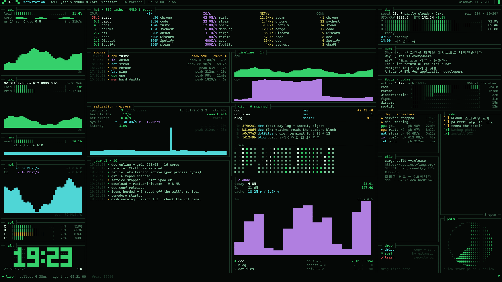
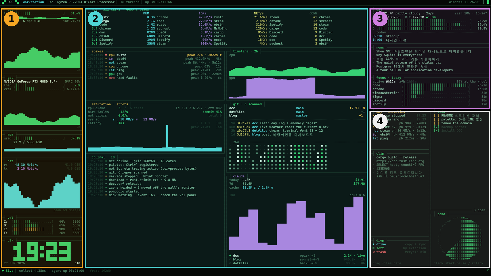
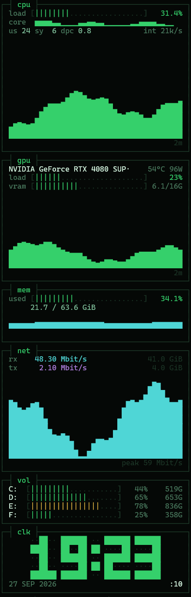
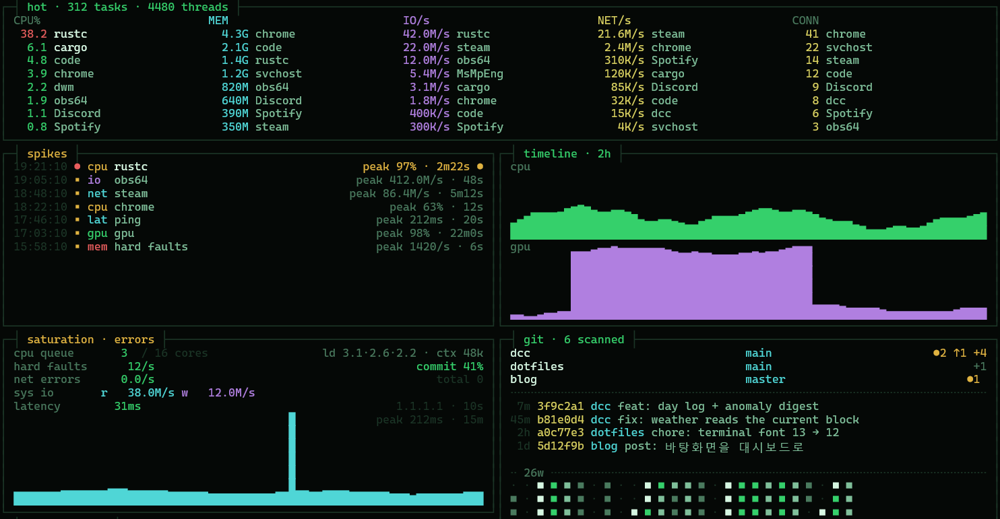
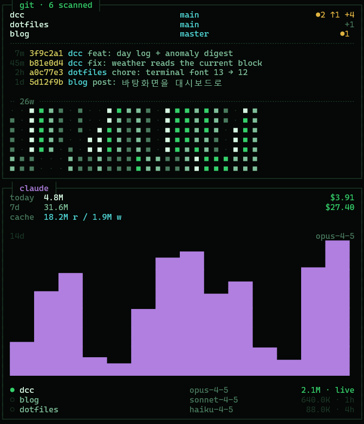
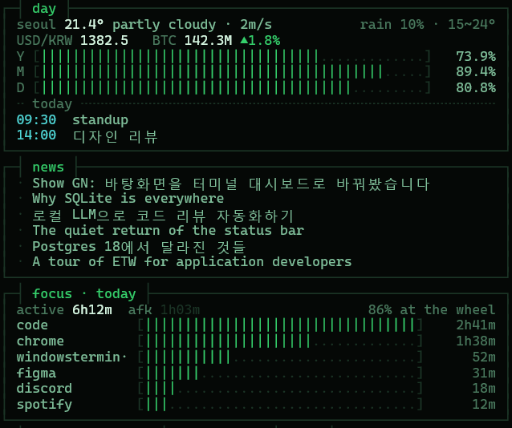
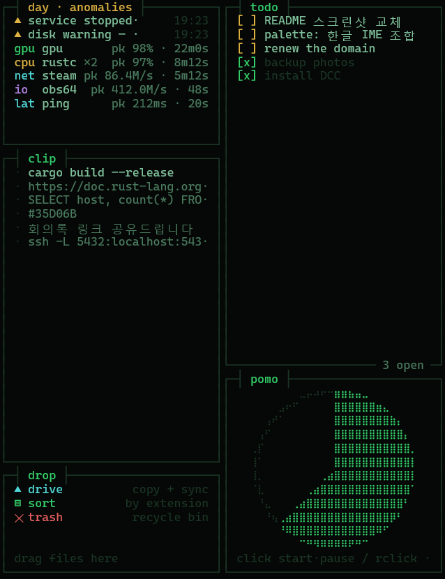

# DCC — DevOps Command Center

A live, clickable dashboard that replaces the Windows desktop wallpaper: system resources, what is using them, your day, and a handful of small tools, drawn as one dense terminal-style screen.

**English** · [한국어](README.ko.md)


<sub>Screenshot rendered with `dcc.exe --shot --demo` (sample data).</sub>

## Requirements

- Windows 10 or 11, 64-bit
- [Rust](https://rustup.rs) (stable) to build
- The Cascadia Mono font (included with Windows 11 and Windows Terminal)

Optional — each lights up one panel, and DCC runs fine without them: an NVIDIA GPU (gpu panel), [git](https://git-scm.com) (git panel), [Claude Code](https://claude.com/claude-code) (claude panel), [ActivityWatch](https://activitywatch.net) (focus panel), [Everything](https://www.voidtools.com) (file search in the palette), Google Drive for Desktop (drop panel).

## Install

```powershell
git clone https://github.com/patissierMongs/dcc-native
cd dcc-native
cargo build --release
target\release\dcc.exe --install
```

`--install` asks for administrator rights once, registers DCC to start at every sign-in, and starts it right away. Administrator rights are what let DCC measure network traffic per process; without them that column shows open connection counts instead.

- Just try it: run `target\release\dcc.exe`, and stop it again with `dcc.exe --stop`.
- Preview in a normal window: `dcc.exe --window`
- Remove: `dcc.exe --uninstall` (your settings stay in `%LOCALAPPDATA%\dcc`)

> The monitor DCC covers stops working as a desktop. With more than one monitor, desktop icons are moved to the other monitors; with a single monitor they sit hidden behind the dashboard. Right-click there no longer opens the desktop menu.

## Using it

The wallpaper never steals keyboard focus. You use it with the mouse, plus one hotkey.

| Action | What happens |
| --- | --- |
| Hover | Highlights rows; on the pomodoro, shows the time left |
| Click | Open a headline · copy a clipboard entry again · tick a todo · open a journal entry's file · open today's log (anomalies panel) · start/pause the pomodoro |
| Right-click | Reset the pomodoro |
| Mouse wheel | Scroll back through the journal |
| Drag files onto the wall | Drop panel: drive / sort / trash |
| <kbd>Ctrl</kbd> + <kbd>`</kbd> | Open the command palette |

**Palette**

| Type | Result |
| --- | --- |
| Part of a launcher name | Runs it (launchers are defined in `dcc.conf`) |
| Any text | File search through Everything, if it is running |
| `+buy milk` | Adds a todo |
| `https://…` | Opens the URL |
| `config`, `todo`, `log`, `data` | Opens DCC's settings, todo file, today's log, or data folder |

## What's on the screen



### ① Resources



- **cpu** — total load, per-core bars, user / system / DPC split, interrupts per second, 2-minute graph
- **gpu** — load, VRAM, temperature and power (NVIDIA)
- **mem** — used out of total, with a graph
- **net** — download and upload rates, transfer totals, graph
- **vol** — space used on each drive
- **clk** — the time, large

<br clear="right">

### ② Tracking



- **hot** — the busiest processes in five columns side by side: CPU, memory, disk I/O, network bytes, open connections
- **spikes** — every burst over a threshold (CPU, I/O, network, GPU, latency, memory pressure) with its peak and duration. A long session such as a game is one line, not a flood of them
- **saturation · errors** — run queue and load averages, hard page faults, commit charge, network errors, disk throughput, ping latency graph
- **journal** — everything DCC noticed: finished downloads, app crashes, stopped services, disk warnings, settings reloads. Click an entry to open it
- **timeline** — the last two hours of CPU and GPU at 30-second resolution



- **git** — repositories found under your folders (branch, uncommitted files, commits ahead), recent commits across all of them, and a 26-week contribution heatmap
- **claude** — Claude Code token use and estimated cost for today and the last 7 days, cache reads and writes, a 14-day chart, and recent sessions

### ③ Your day



- **day** — weather, the USD exchange rate and one crypto price, how far through the year / month / day you are, and today's calendar events
- **news** — headlines from your RSS or Atom feeds (GeekNews by default); click to open
- **focus** — screen time per app today, from ActivityWatch

### ④ Tools



- **day · anomalies** — today's warnings and spikes, grouped by what caused them. Click for the full day log
- **clip** — clipboard history; click an entry to copy it again
- **drop** — drag files onto the wall: **drive** copies them to a synced folder (Google Drive by default), **sort** moves them into `Documents\dcc-sorted\<extension>`, **trash** sends them to the Recycle Bin
- **todo** — `TODO.md` in your user folder; click to tick items off, or edit the file in any editor
- **pomo** — a 25-minute pomodoro drawn as a slowly filling dial. No numbers unless you hover

## Settings

Open them from the palette: <kbd>Ctrl</kbd> + <kbd>`</kbd>, then type `config`. Saved changes apply immediately, no restart needed.

```ini
[launcher]
Notepad  | notepad.exe
Terminal | wt.exe

[rss]
https://news.hada.io/rss/news

[calendar]
https://calendar.google.com/calendar/ical/.../basic.ics

[weather]
city = Seoul
lat = 37.5665
lon = 126.978

[ticker]
currency = KRW
coin = KRW-BTC

[git]
%USERPROFILE%\Documents

[drop]
drive = G:\My Drive\Inbox

[display]
pixel_shift = on
night_dim = 0.55
night_hours = 23-08
theme = phosphor
```

| Section | Meaning |
| --- | --- |
| `launcher` | `label \| target \| args` — an exe, a folder, a URL or a `shell:` path; searchable from the palette |
| `rss` | One feed URL per line |
| `calendar` | The *secret address in iCal format* from Google Calendar (Settings → your calendar). Treat it like a password |
| `weather` | Label and coordinates for the forecast |
| `ticker` | `currency`: what the USD rate is quoted in. `coin`: any [Upbit](https://upbit.com) market such as `KRW-BTC` or `USDT-ETH`. Use `off` to hide either |
| `git` | Folders scanned two levels deep for repositories |
| `drop` | Where the drive zone copies files; auto-detects Google Drive when left out |
| `display` | `pixel_shift` moves the picture a few pixels every 5 minutes and `night_dim` darkens it during `night_hours` (OLED care); `theme = soft` lowers saturation |

## Files and privacy

| Path | Contents |
| --- | --- |
| `%LOCALAPPDATA%\dcc\dcc.conf` | Settings |
| `%LOCALAPPDATA%\dcc\logs\dcc-day-YYYYMMDD.log` | Day log: journal entries and spikes |
| `%LOCALAPPDATA%\dcc\dcc.log` | Diagnostics |
| `%USERPROFILE%\TODO.md` | Todo list |

Everything stays on your machine. DCC only contacts Open-Meteo (weather), open.er-api.com (exchange rate), Upbit (crypto price), the feeds and calendar address you configure, `1.1.1.1` (latency ping), and ActivityWatch on localhost. There is no telemetry.

## Command line

| Command | Does |
| --- | --- |
| `dcc.exe` | Run as the wallpaper on the primary monitor |
| `dcc.exe --install` / `--uninstall` | Start at every sign-in / remove that |
| `dcc.exe --stop` | Stop the running wallpaper |
| `dcc.exe --monitor N` | Use monitor N (0-based) instead of the primary one |
| `dcc.exe --all` | Span every monitor |
| `dcc.exe --window` | Preview in a normal window |
| `dcc.exe --shot out.png [width height] [--demo]` | Render one frame to a PNG; `--demo` uses sample data |
| `dcc.exe --help` | Show this list |

## License

[MIT](LICENSE)
